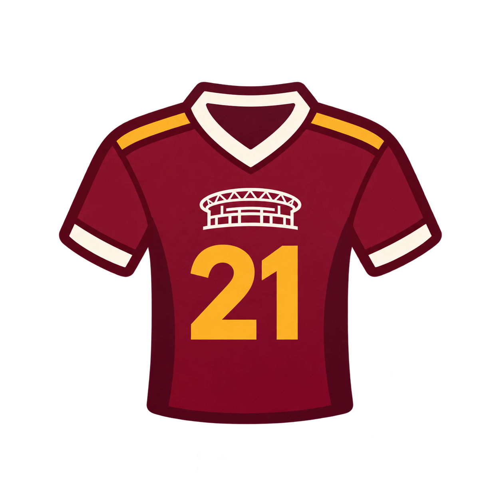

#  Trabalho Prático: Web Services (REST e SOAP)

Este repositório contém a entrega da atividade prática da disciplina de **Sistemas Distribuídos / Web Services**.

O objetivo do projeto é explorar a diversidade tecnológica de ecossistemas web através da pesquisa e do consumo prático de Web Services reais disponíveis publicamente, separando as implementações em duas aplicações independentes.

---

## 📁 Estrutura do Repositório

Para facilitar a avaliação e isolar os ecossistemas, o projeto foi dividido em dois diretórios principais:

- **[`/rest`](./rest/)**: Aplicação Full-Stack (Python/FastAPI + React) consumindo a PokeAPI.
- **[`/soap`](./soap/)**: Aplicação consumindo um Web Service baseado em WSDL _(a ser definido pela equipe)_.

Cada diretório possui seu próprio `README.md` com instruções detalhadas de instalação, execução e exemplos dos dados trafegados.

---

## 🌐 1. Aplicação REST (Pokédex)

A aplicação localizada na pasta `/rest` funciona como uma Pokédex que consome a [PokeAPI (The RESTful Pokémon API)](https://pokeapi.co/docs/v2).

- **Arquitetura:** Frontend em React (Vite) e Backend em Python (FastAPI).
- **Formato de Dados:** JSON.
- **Exemplo de Retorno:** Ao buscar os dados, a API recebe a estrutura abaixo:

 **Exemplo (Rayquaza):**

```json
{
  "name": "rayquaza",
  "stats": [
    {
      "base_stat": 150,
      "stat": { "name": "attack" }
    }
  ]
}
```

> **Instruções de execução:** Para rodar a aplicação REST, acesse a pasta [`/rest`](./rest/) e siga o passo a passo no README interno.

---

##  2. Aplicação SOAP (CAMISA 21)

A aplicação localizada na pasta [`/soap`](./soap/) é chamada **CAMISA 21**, uma plataforma de estatísticas de futebol que utiliza o Football Pool Web Service para consultar dados de partidas, seleções, jogadores, estádios e outras informações relacionadas à Copa do Mundo.

O projeto demonstra a comunicação entre sistemas utilizando **SOAP**, mensagens **XML** e um contrato **WSDL**.

- **Arquitetura:** Frontend em React (Vite) e backend em Python (FastAPI).
- **Cliente SOAP:** Zeep.
- **Web Service escolhido:** Football Pool Web Service.
- **Formato de dados:** XML (SOAP Envelope).
- **Documentação:** https://footballpool.dataflex.dev/info.wso
- **WSDL utilizado:** https://footballpool.dataflex.dev/info.wso?WSDL

###  Exemplo de retorno SOAP

**Operação:** `GoalsScored`

Essa operação retorna o total de gols registrado no conjunto de dados disponibilizado pelo serviço.

Na consulta apresentada, o resultado recebido foi de **307 gols**.

```xml
<?xml version="1.0" encoding="utf-8"?>
<soap:Envelope xmlns:soap="http://schemas.xmlsoap.org/soap/envelope/">
  <soap:Body>
    <m:GoalsScoredResponse xmlns:m="https://footballpool.dataaccess.eu">
      <m:GoalsScoredResult>307</m:GoalsScoredResult>
    </m:GoalsScoredResponse>
  </soap:Body>
</soap:Envelope>
```

O elemento `soap:Envelope` representa a estrutura principal da mensagem SOAP, enquanto `soap:Body` contém a resposta da operação executada.

O elemento `GoalsScoredResult` apresenta o resultado retornado pelo Web Service.

O backend utiliza a biblioteca **Zeep** para interpretar a resposta SOAP/XML e converter os dados para JSON, permitindo sua apresentação no frontend React.

### 📚 Documentações

- [Football Pool Web Service](https://footballpool.dataflex.dev/info.wso)
- [Contrato WSDL](https://footballpool.dataflex.dev/info.wso?WSDL)
- [Documentação do Zeep](https://docs.python-zeep.org/en/master/)
- [Documentação do FastAPI](https://fastapi.tiangolo.com/)

> **Instruções de execução:** Para rodar a aplicação SOAP, acesse a pasta [`/soap`](./soap/) e siga o passo a passo no [README interno](./soap/README.md).

---

## 📋 Comparação entre REST e SOAP

| Característica | REST (Pokédex) | SOAP (CAMISA 21) |
|---|---|---|
| Serviço | PokeAPI | Football Pool |
| Comunicação | HTTP/REST | SOAP sobre HTTP |
| Formato externo | JSON | XML |
| Documentação | API REST | WSDL |
| Frontend | React | React |
| Backend | FastAPI | FastAPI |
| Biblioteca de integração | Cliente HTTP | Zeep |

---

## 📌 Objetivo Acadêmico

As aplicações demonstram duas abordagens de comunicação entre sistemas.

A **Pokédex** utiliza uma API REST que disponibiliza dados em JSON.

O **CAMISA 21** utiliza um Web Service SOAP cujo contrato WSDL descreve as operações disponíveis. As respostas são recebidas em XML, processadas pelo backend e apresentadas em uma interface web.

Dessa forma, o projeto permite observar, na prática, as diferenças entre REST e SOAP.
