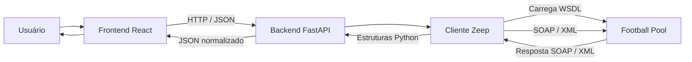

# 1.  CAMISA 21

**CAMISA 21** é uma plataforma acadêmica de estatísticas de futebol com React, FastAPI e integração SOAP. A interface apresenta o acervo da Copa do Mundo 2026 disponível no Football Pool: partidas, seleções, jogadores, estádios, comparações e um laboratório SOAP.


O objetivo é demonstrar o consumo de um **Web Service SOAP** público por mensagens **XML** orientadas por um contrato **WSDL**, integrando frontend e backend, convertendo respostas e tratando falhas.


## 2. Tecnologias utilizadas

| Camada | Tecnologias verificadas no projeto |
|---|---|
| Frontend | React/React DOM 19, TypeScript 5.7, Vite 6, React Router 7, Axios 1 |
| Interface | Tailwind CSS 3, CSS próprio, Recharts 2, Lucide React |
| Backend | Python 3.11+, FastAPI, Pydantic 2, Pydantic Settings, Uvicorn |
| SOAP | Zeep 4, Requests e lxml; SOAP 1.1, XML e WSDL 1.1 |


Dependências: [requirements.txt](backend/requirements.txt), [package.json](frontend/package.json) e [pnpm-lock.yaml](frontend/pnpm-lock.yaml). Pydantic e lxml são usados diretamente e instalados pelas dependências já declaradas de FastAPI/Pydantic Settings e Zeep. Não há banco de dados ou autenticação.


## 3. Arquitetura



React consulta a API interna HTTP/JSON com Axios. FastAPI valida, chama o cliente SOAP e devolve estruturas normalizadas. Zeep comunica-se com o provedor por SOAP/XML. O navegador não envia SOAP diretamente.

```text
soap/
├── frontend/
│   ├── public/                  # Banner atual e favicon
│   ├── src/
│   │   ├── assets/
│   │   ├── components/          # Cards, estados, gráficos e painéis XML
│   │   ├── hooks/               # Carregamento e fonte dos dados
│   │   ├── layouts/
│   │   ├── pages/
│   │   ├── services/            
│   │   ├── styles/
│   │   ├── test/
│   │   ├── types/
│   │   └── main.tsx             # Inicialização React e rotas
│   ├── package.json
│   ├── pnpm-lock.yaml
│   └── vite.config.ts
├── backend/
│   ├── app/
│   │   ├── config/
│   │   ├── routes/
│   │   ├── schemas/
│   │   ├── services/
│   │   └── main.py              # Aplicação FastAPI
│   ├── tests/
│   ├── pytest.ini
│   └── requirements.txt
├── scripts/
├── .vscode/                     
├── .env.example
├── .gitignore
└── README.md
```


## 4. Funcionamento da integração SOAP

**SOAP** é um protocolo de mensagens estruturadas. **XML** representa elementos, atributos e namespaces. **WSDL** descreve operações, parâmetros, tipos, bindings e endereços. Zeep usa o contrato para construir requisições e interpretar respostas.

O **Envelope** delimita a mensagem; o **Header** opcional contém metadados; o **Body** contém a operação ou resposta. **SOAP Fault** representa um erro estruturado. REST é um estilo arquitetural, não um formato de dados. A comunicação interna HTTP/JSON não substitui a integração SOAP externa.

Em [soap.py](backend/app/services/soap.py), `SoapService.execute` valida a allowlist e os parâmetros, cria cliente/sessão/transporte próprios, verifica a operação no contrato, chama `client.service` e converte o resultado com `serialize_object` e `jsonable_encoder`.

`CaptureTransport.post` captura os corpos XML enviados e recebidos no transporte do Zeep. Cada execução tem seu transporte: não existe um último envelope global compartilhado entre usuários. O WSDL fica em cache por uma hora; o conjunto normalizado, por até cinco minutos. A carga utiliza até quatro chamadas concorrentes. A duração do laboratório inclui inicialização e eventual carregamento do contrato.

Há tratamento de Fault, timeout, conexão e incompatibilidade de contrato. Parâmetros inválidos geram HTTP 422; falhas do conjunto geram 503, sem fallback automático. O laboratório devolve `ok=false` e os XMLs disponíveis; a consulta de classificação do provedor usa 502 quando falha.

TLS permanece verificado. DTDs, entidades e referências XML externas são proibidas. Logs não gravam envelopes, cookies ou credenciais. O timeout padrão de WSDL e operações é de 20 segundos por chamada.

## 5. WSDL utilizado

**Link direto:** [https://footballpool.dataflex.dev/info.wso?WSDL](https://footballpool.dataflex.dev/info.wso?WSDL).

O contrato descreve mensagens, tipos e bindings. Seu namespace é `https://footballpool.dataaccess.eu`, enquanto o endpoint é `https://footballpool.dataflex.dev/info.wso`. Namespace identifica o vocabulário XML e não precisa ser o endereço HTTP.

## 6. Documentações oficiais

### Serviço externo e integração

- [Football Pool — operações](https://footballpool.dataflex.dev/info.wso)
- [DataFlex — Server Side Web Services](https://docs.dataflex.dev/DevelopmentGuide/Server_Side_Web_Services/)
- [Zeep](https://docs.python-zeep.org/en/master/)
- [Requests](https://requests.readthedocs.io/en/latest/)
- [lxml](https://lxml.de/)

### Frontend

- [React](https://react.dev/) e [TypeScript](https://www.typescriptlang.org/docs/)
- [Vite](https://vite.dev/guide/) e [Tailwind CSS 3](https://v3.tailwindcss.com/docs/installation)
- [React Router](https://reactrouter.com/start/declarative/installation)
- [Axios](https://axios-http.com/docs/intro)
- [Recharts](https://recharts.github.io/en-US/api/)
- [Lucide React](https://lucide.dev/guide/packages/lucide-react)
- [PostCSS](https://postcss.org/), [Autoprefixer](https://github.com/postcss/autoprefixer#readme) e [Prettier](https://prettier.io/docs/)

### Backend, testes e execução

- [Python 3.11](https://docs.python.org/3.11/) e [FastAPI](https://fastapi.tiangolo.com/)
- [Pydantic](https://docs.pydantic.dev/latest/) e [Pydantic Settings](https://docs.pydantic.dev/latest/concepts/pydantic_settings/)
- [Uvicorn](https://uvicorn.dev/)
- [Pytest](https://docs.pytest.org/en/stable/) e [HTTPX](https://www.python-httpx.org/)
- [Vitest](https://vitest.dev/guide/)
- [Testing Library](https://testing-library.com/docs/react-testing-library/intro/), [jest-dom](https://github.com/testing-library/jest-dom#readme) e [jsdom](https://github.com/jsdom/jsdom#readme)
- [Node.js](https://nodejs.org/en/download) e [pnpm](https://pnpm.io/installation)

## 7. Operações SOAP utilizadas

**Conjunto** designa as oito operações em `CALLS` de football.py, executadas em modo online quando o cache expira. **Laboratório** significa execução sob demanda. A lista corresponde à allowlist de soap.py e às rotas existentes.

| Operação | Finalidade | Parâmetros | Uso |
|---|---|---|---|
| TeamNames | Nomes de seleções | Nenhum | Conjunto e laboratório |
| ResultsAllGames | Partidas e placares | `iGroupId: int`, `iLevel: int`; conjunto envia `0, 0` | Conjunto, partidas, estatísticas e laboratório |
| AllPlayerNames | IDs, nomes, países e bandeiras | `bSelected: boolean`; conjunto envia `false` | Conjunto, jogadores e laboratório |
| PlayersWithGoalsRanked | Ranking de gols por ID | Nenhum | Conjunto, artilharia e laboratório |
| AllStadiumInfo | Estádios, capacidades, cidades e links | Nenhum | Conjunto e laboratório |
| GroupInfo | Grupos e fases | Nenhum | Conjunto, filtros e laboratório |
| AllCardsInfo | Eventos de cartões | Nenhum | Conjunto, detalhes e laboratório |
| GameIDsGroupedByCity | Partidas por cidade | Nenhum | Conjunto, localização e laboratório |
| GroupStandings | Classificação do provedor | `iGroupId: int` | Endpoint de classificação e laboratório |
| Teams | Busca de seleções | `sTeamName: string` | Laboratório |
| Players | Busca de jogadores | `sName: string` | Laboratório |
| TeamPlayers | Jogadores de uma seleção | `sTeamName: string`, `bSelected: boolean` | Laboratório |
| GameScore | Resultado individual | `iGameNumber: int` | Laboratório e script de teste HTTP |
| MatchDates | Datas do conjunto | Nenhum | Laboratório |
| GoalsScored | Total de gols do provedor | Nenhum | Laboratório e captura da entrega |
| TopScorersList | Cinco registros de artilharia | Nenhum | Laboratório |
| StadiumInfo | Estádio por nome | `sStadiumName: string` | Laboratório |
| StadiumNames | Nomes de estádios | Nenhum | Laboratório |
| Cards | Total de cartões | `bYellow: boolean`, `iGameNumber: int` | Laboratório |


## 8. Exemplo de XML recebido


```xml
<?xml version="1.0" encoding="utf-8"?>
<soap:Envelope xmlns:soap="http://schemas.xmlsoap.org/soap/envelope/">
  <soap:Body>
    <m:GoalsScoredResponse xmlns:m="https://footballpool.dataaccess.eu">
      <m:GoalsScoredResult>307</m:GoalsScoredResult>
    </m:GoalsScoredResponse>
  </soap:Body>
</soap:Envelope>
```

O exemplo apresenta uma resposta recebida pelo **CAMISA 21** após a execução da operação `GoalsScored`, disponibilizada pelo Football Pool Web Service por meio do protocolo SOAP.

Essa operação não exige parâmetros de entrada e retorna a quantidade total de gols registrada no conjunto de dados disponibilizado pelo serviço. Na consulta apresentada, o valor retornado foi **307 gols**.

A resposta segue a estrutura padrão do SOAP, utilizando XML para organizar as informações:

- **`<?xml version="1.0" encoding="utf-8"?>`**: identifica a versão do XML e a codificação utilizada.
- **`soap:Envelope`**: representa o elemento principal da mensagem SOAP.
- **`soap:Body`**: contém os dados da resposta enviada pelo Web Service.
- **`GoalsScoredResponse`**: identifica a resposta da operação solicitada.
- **`GoalsScoredResult`**: contém o resultado da consulta, neste caso, o valor `307`.
- **`xmlns`**: define os namespaces utilizados para identificar corretamente os elementos XML.

Após receber a mensagem SOAP, o backend utiliza a biblioteca **Zeep** para interpretar a resposta XML e extrair o resultado. Em seguida, o FastAPI disponibiliza os dados processados em formato JSON para o frontend React, permitindo sua apresentação na interface do CAMISA 21.


## 9. Como executar o projeto


### Ambiente virtual e dependências do backend

```powershell
py -3 -m venv .venv
.\.venv\Scripts\Activate.ps1
python -m pip install -r backend/requirements.txt
```

Se a ativação for bloqueada, não é necessário alterar a política do Windows. Use o executável diretamente:

```powershell
.\.venv\Scripts\python.exe -m pip install -r backend/requirements.txt
```

Crie o arquivo `.env` apenas se ele ainda não existir:

```powershell
if (!(Test-Path .env)) { Copy-Item .env.example .env }
```

| Variável | Padrão |
|---|---|
| SOAP_WSDL | https://footballpool.dataflex.dev/info.wso?WSDL |
| SOAP_TIMEOUT | 20 segundos por carregamento/operação |
| CACHE_SECONDS | 300 segundos |

### Terminal 1 — backend

Na raiz:

```powershell
.\.venv\Scripts\python.exe -m uvicorn app.main:app --app-dir backend --reload --host 127.0.0.1 --port 8000
```

### Terminal 2 — frontend

Em outro terminal, inicialmente na raiz:

```powershell
npm install --global pnpm@11.25.0
cd frontend
pnpm install --frozen-lockfile
pnpm dev
```

Abra **http://127.0.0.1:5173/**. O proxy Vite encaminha /api ao backend na porta 8000. Mantenha os dois terminais abertos. Se Vite escolher outra porta por ocupação, use a URL impressa; revise CORS_ORIGINS se acessar o backend diretamente.

### Executar SOAP e inspecionar XML

1. Abra **SOAP** na aplicação.
2. Selecione **GoalsScored**, sem parâmetros.
3. Clique em **Executar requisição**.
4. Confira **XML enviado**, **XML recebido**, JSON e duração.
5. Use os botões de copiar/baixar XML.


```powershell
$body = @{ operation = 'GoalsScored'; params = @{} } | ConvertTo-Json
$resultado = Invoke-RestMethod -Uri 'http://127.0.0.1:8000/api/soap/execute' -Method Post -ContentType 'application/json' -Body $body
$resultado.ok
$resultado.response_xml
```


## 10. Funcionalidades existentes

| Página | Recursos |
|---|---|
| Início | Indicadores, partidas, artilheiros, gols por dia, grupos e seleções |
| Partidas | Busca, filtros por grupo/fase, data e situação; detalhes em abas |
| Seleções | Busca, partidas, estatísticas e cadastro de jogadores relacionado |
| Jogadores | Busca, filtro de seleção, ranking, carregamento progressivo e detalhes |
| Estádios | Busca por nome/cidade, capacidade, links e partidas na cidade |
| Comparações | Duas seleções distintas, tabela, gráfico, período e fórmula |
| Laboratório SOAP | Operações, parâmetros, chamada real, XMLs, JSON, duração e erros |
| Sobre | Arquitetura, fórmulas, fontes e limitações |
| Busca global | Seleções, jogadores, partidas e estádios |


### Endpoints internos

GET: /api/health, /api/dashboard, /api/teams, /api/teams/{name}, /api/matches, /api/matches/{id}, /api/players, /api/stadiums, /api/comparison, /api/groups/{id}/standings e /api/soap/operations.

POST: /api/soap/execute.

